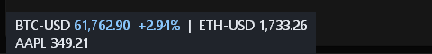

# Coin & Stock Monitor

A [Windhawk](https://windhawk.net) mod that shows live stock and crypto prices on the
left side of the Windows 11 taskbar. Each symbol can show its entry price, with the
signed percentage change and a green or red color.

Prices come from a configurable JSON API. The default is the Yahoo Finance chart API,
which needs no API key and covers both stocks (`AAPL`, `VNM.VN`) and crypto
(`BTC-USD`, `ETH-USD`).

## Features

- Stocks and crypto with the default API, or any JSON API you configure.
- Up to 4 symbols, shown 2 per line.
- Whole prices drop the decimals, and large numbers get thousands separators
  (for example `11,200` and `82,122,650.56`).
- Entry prices: `SYMBOL=PRICE` pairs show the signed percentage change from the entry.
  Prices at or above the entry use the gain color, and prices below use the loss color.
- Left or right text alignment, coordinated color presets or custom colors, offset, and width.
- Optional solid background for transparent taskbar themes such as DockLike.

## Network access

The mod sends HTTPS requests from `explorer.exe` to the URL set in **Price API URL**.
By default that is `query1.finance.yahoo.com`. It sends one request per symbol (up to
4) at startup, then once every **Refresh interval** (default 60 seconds). Each request
identifies the mod by name in its User-Agent header. No other data is sent. To
stop all requests, disable the mod.

## Requirements

- Windows 11, with a horizontal taskbar on the primary monitor.
- Windhawk 1.7 or newer. Tested with Windhawk 1.7.3.
- An internet connection.

## Install

1. Install [Windhawk](https://windhawk.net).
2. Download `coin-stock-monitor.wh.cpp` from the [latest release](../../releases/latest).
3. In Windhawk, create a new mod, paste the full contents of the file, and compile it.
4. Enable the mod. Settings appear in Windhawk's mod settings panel.

## Settings

The settings form has four groups instead of a flat list. Windhawk 1.7.3 renders
these as separate cards; newer UI behavior can vary. No conditional hiding or
collapsing is assumed.

| Group | Settings | When to change |
| --- | --- | --- |
| **Content** | Symbols, optional entry prices, refresh interval | Pick what to track. Up to 4 symbols, 2 per line; refresh at least every 15 seconds. |
| **Appearance** | Color preset, Background | Pick a palette, then Transparent, Solid - full area, or Solid - fit text. |
| Appearance → **Custom colors** | Text, Gain, Loss, Solid background | Used only with Custom. New installs use Slate colors. Empty Text follows the Windows taskbar theme. Avoid `#FF00FF` text colors in Transparent mode. |
| **Placement** | Text alignment, Left offset, Width | Position the monitor; offsets and width scale with Windows DPI. |
| **Data source (advanced)** | Price API URL, Price JSON key | Leave unchanged for Yahoo Finance, or configure a different JSON API. |

Changing any setting reloads the mod. The full set has **14 options** in four
groups, with the four Custom colors in a sub-group. No existing capability was
removed: the old Background mode and Background sizing are one selector now.

### Background and placement

- **Transparent** draws only text.
- **Solid - full area** fills the monitor width and taskbar height.
- **Solid - fit text** hugs both lines as one rectangle, following price updates.
  Padding is 8 pixels horizontally and 3 vertically at 100% scaling. The height
  is centered and limited to the taskbar height.

Named presets include matching Solid backgrounds. Custom uses its own Solid
background color. With Fit text, **Placement → Width** still sets the alignment
area: left alignment fixes the left edge; right alignment fixes the right edge.
**Left offset + Width** should end before Start to avoid covering task buttons.
The solid background improves readability with DockLike, but does not reserve
space in the taskbar or join the dock's background.

### Upgrading from flat settings (1.2.x or early 1.3.0)

The settings are now grouped into Content, Appearance, Placement and Data source.
Grouping changes the setting paths, so Windhawk cannot carry the old flat values
into the new cards automatically. After updating, re-enter your symbols, entry
prices, colors, background mode, placement and API settings once. The old values
are not deleted from storage, but the new grouped form uses its own defaults until
you configure it.

### Example: CoinGecko

- **Data source → Price API URL**: `https://api.coingecko.com/api/v3/simple/price?ids={symbol}&vs_currencies=usd`
- **Data source → Price JSON key**: `usd`
- **Content → Symbols**: `bitcoin|ethereum`
- **Content → Entry prices**: `bitcoin=60000`

Entry prices use `SYMBOL=PRICE` pairs separated by `|`. Use `.` for decimals;
commas are thousands separators (`12,005` means `12005`, while `0,45` is rejected).
Comma-separated lists from older versions remain supported by the mod.

## Limitations

- Horizontal taskbar on the primary monitor only.
- The monitor is placed by pixel offset, so it assumes the Start button is centered.
  With a left-aligned Start button, the monitor overlaps Start.
- With many apps open, or a wide monitor area, the monitor can cover part of the task
  list. Reduce **Placement → Width** if that happens.
- The default Yahoo Finance endpoint is unofficial and may rate-limit or change. Check
  its terms before heavy use, and change the API URL if needed.

## License

[MIT](LICENSE)
