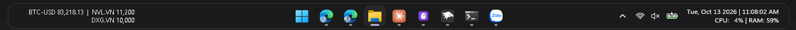

# Coin & Stock Monitor

A [Windhawk](https://windhawk.net) mod that shows live stock and crypto prices on the
left side of the Windows 11 taskbar. Each symbol can show its entry price, with the
signed percentage change and a green or red color.

Prices come from a configurable JSON API. The default is the Yahoo Finance chart API,
which needs no API key and covers both stocks (`AAPL`, `VNM.VN`) and crypto
(`BTC-USD`, `ETH-USD`).

## Features

- Stocks and crypto with the default API, or any JSON API you configure.
- Up to 4 symbols, shown 2 per line.
- Whole prices drop the decimals, and large numbers get thousands separators
  (for example `11,200` and `82,122,650.56`).
- Entry prices: `SYMBOL=PRICE` pairs show the signed percentage change from the entry.
  Prices at or above the entry use the gain color, and prices below use the loss color.
- Left or right text alignment, text color, gain and loss colors, offset, and width.

## Network access

The mod sends HTTPS requests from `explorer.exe` to the URL set in **Price API URL**.
By default that is `query1.finance.yahoo.com`. It sends one request per symbol (up to
4) at startup, then once every **Refresh interval** (default 60 seconds). Each request
identifies the mod by name in its User-Agent header. No other data is sent. To
stop all requests, disable the mod.

## Requirements

- Windows 11, with a horizontal taskbar on the primary monitor.
- Windhawk 1.7 or newer. Tested with Windhawk 1.7.3.
- An internet connection.

## Install

1. Install [Windhawk](https://windhawk.net).
2. Download `coin-stock-monitor.wh.cpp` from the [latest release](../../releases/latest).
3. In Windhawk, create a new mod, paste the full contents of the file, and compile it.
4. Enable the mod. Settings appear in Windhawk's mod settings panel.

## Settings

| Setting | Default | What it does |
| --- | --- | --- |
| Price API URL | Yahoo Finance chart URL | Requested once per symbol. `{symbol}` is replaced with the URL-encoded symbol. |
| Price JSON key | `regularMarketPrice` | The key whose numeric value is the price in the response. |
| Symbols | `BTC-USD,ETH-USD,AAPL` | Comma-separated, in order. At most 4 symbols, 2 per line. |
| Entry prices | empty | Comma-separated `SYMBOL=PRICE` pairs, for example `BTC-USD=60000,AAPL=300`. |
| Text alignment | left | Aligns the text inside the monitor area. |
| Text color | `#19FF00` | Color for symbols and prices without an entry price. Leave empty to follow the taskbar theme. |
| Gain color | `#00A850` | Color for prices and percentages at or above their entry price. |
| Loss color | `#E0301E` | Color for prices and percentages below their entry price. |
| Left offset | 8 | Distance from the left edge of the taskbar, in pixels at 100% scaling. |
| Monitor width | 480 | Width of the monitor area, in pixels at 100% scaling. The area grows if the text is wider. |
| Refresh interval | 60 | Seconds between fetches. Values below 15 are raised to 15. |

Changing any setting reloads the mod.

### Example: CoinGecko

- Price API URL: `https://api.coingecko.com/api/v3/simple/price?ids={symbol}&vs_currencies=usd`
- Price JSON key: `usd`
- Symbols: `bitcoin,ethereum` (CoinGecko coin ids, not ticker symbols)
- Entry prices: `bitcoin=60000`

## Limitations

- Horizontal taskbar on the primary monitor only.
- The monitor is placed by pixel offset, so it assumes the Start button is centered.
  With a left-aligned Start button, the monitor overlaps Start.
- With many apps open, or a wide monitor area, the monitor can cover part of the task
  list. Reduce **Monitor width** if that happens.
- The default Yahoo Finance endpoint is unofficial and may rate-limit or change. Check
  its terms before heavy use, and change the API URL if needed.

## License

[MIT](LICENSE)
